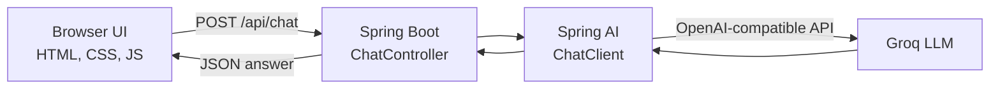

<div align="center">

# ✦ Adarsh's AI

**A full-stack AI chat app with a ChatGPT/Claude-style interface, built with Spring Boot, Spring AI and Groq.**


</div>

<!-- Add a screenshot at docs/screenshot.png and it will show up here -->
<p align="center">
  
    
</p>


---

## ✨ Features

**Chat experience**
- Chat history in a sidebar, grouped by Today, Yesterday and Previous 7 days
- Search, star and delete chats
- Conversation memory, so the AI remembers earlier messages in a chat
- Answer styles: Balanced, Concise, Detailed and Code mentor
- Gradual reply effect with a Stop button, plus Regenerate, Copy and Good/Bad feedback
- Markdown rendering with one-click copy on code blocks
- Artifacts view that collects every code block from all your chats
- Voice input (Chrome and Edge) and export of any chat to Markdown

**Personalization**
- Time-based greeting with your name and initials avatar
- Dark and light themes with four accent colors
- Keyboard shortcuts: `Ctrl+K` to search, `Ctrl+Shift+O` for a new chat
- Fully responsive, with a slide-out sidebar on mobile

**Backend**
- REST API built with Spring Boot and Spring AI `ChatClient`
- Works with any OpenAI-compatible provider (Groq by default)
- API key kept in an environment variable, never in code
- Single deployable app: the UI is served by Spring Boot
- Dockerfile included for one-command deployment

---

## 🏗️ Architecture



Chats are stored in the browser (`localStorage`), so the backend stays stateless and easy to scale.

---

## 🧰 Tech Stack

| Layer | Technology |
|---|---|
| Backend | Java, Spring Boot 4.1, Spring Web MVC |
| AI integration | Spring AI 2.0 (`spring-ai-starter-model-openai`) |
| LLM provider | Groq (OpenAI-compatible API), model `openai/gpt-oss-20b` |
| Frontend | HTML, CSS, vanilla JavaScript, marked, DOMPurify |
| Build tool | Maven |
| Deployment | Docker, Render or AWS EC2 |

---

## 📁 Project Structure

```
ai-model/
├── AI-Model/
│   ├── src/main/java/com/example/AI_Model/
│   │   ├── AiModelApplication.java     # Spring Boot entry point
│   │   └── ChatController.java         # POST /api/chat endpoint
│   ├── src/main/resources/
│   │   ├── application.properties      # Provider and model config
│   │   └── static/index.html           # Chat UI
│   ├── Dockerfile
│   └── pom.xml
├── .gitignore
└── README.md
```

---

## 🚀 Getting Started

### Prerequisites

- Java 21 or newer
- Maven (or use the included Maven wrapper)
- A free API key from [Groq Console](https://console.groq.com)

### 1. Clone the repository

```bash
git clone https://github.com/GitadarshSingh/ai-model.git
cd ai-model/AI-Model
```

### 2. Set your API key

Never commit your key. Set it as an environment variable instead.

**Windows (PowerShell)**
```powershell
$env:GROQ_API_KEY="your_groq_key"
```

**macOS / Linux**
```bash
export GROQ_API_KEY=your_groq_key
```

### 3. Run the app

```bash
./mvnw spring-boot:run
```

On Windows, use `mvnw.cmd spring-boot:run`.

### 4. Open it

Go to **http://localhost:8080** and start chatting.

---

## ⚙️ Configuration

`src/main/resources/application.properties`

```properties
spring.application.name=AI-Model
spring.ai.openai.api-key=${GROQ_API_KEY}
spring.ai.openai.base-url=https://api.groq.com/openai/v1
spring.ai.openai.chat.options.model=openai/gpt-oss-20b
server.port=${PORT:8080}
```

To switch provider, change `base-url`, `api-key` and `model`. Any OpenAI-compatible service works. Model names change over time, so check your provider's model list if you get a 404.

---

## 🔌 API Reference

### `POST /api/chat`

**Request**
```json
{ "question": "What is Spring Boot?" }
```

**Response**
```json
{ "answer": "Spring Boot is a framework that ..." }
```

**Try it with curl**
```bash
curl -X POST http://localhost:8080/api/chat \
  -H "Content-Type: application/json" \
  -d '{"question":"Explain Java streams in two lines"}'
```

---

## 🐳 Docker

```bash
docker build -t ai-chat .
docker run -p 8080:8080 -e GROQ_API_KEY=your_groq_key ai-chat
```

## ☁️ Deploy

**Render**
1. Push this repo to GitHub.
2. In Render, choose **New → Web Service** and connect the repo.
3. Set the root directory to `AI-Model` and the runtime to **Docker**.
4. Add the environment variable `GROQ_API_KEY`.
5. Deploy.

**AWS EC2**
```bash
docker build -t ai-chat .
docker run -d -p 80:8080 -e GROQ_API_KEY=your_groq_key ai-chat
```
Open port 80 in the instance's security group.

---

## 🔒 Security Notes

- Keep API keys in environment variables or a secrets manager, never in the repository.
- Add `target/` and `.idea/` to `.gitignore`.
- Restrict `@CrossOrigin` to your own domain before going to production.
- If a key is ever exposed, delete it in the provider console and create a new one.

---

## 🗺️ Roadmap

- [ ] Real token streaming from the backend (Server-Sent Events)
- [ ] Persistent chat storage with MySQL
- [ ] User login with JWT
- [ ] CI/CD pipeline with Jenkins and SonarQube
- [ ] Infrastructure as code with Terraform on AWS

---

## 👤 Author

**Adarsh Singh**

Final-year Computer Science and Engineering student, building with Java, Spring Boot and React.

- GitHub: [@GitadarshSingh](https://github.com/GitadarshSingh)

---

<div align="center">

If you found this project useful, consider giving it a ⭐

</div>
